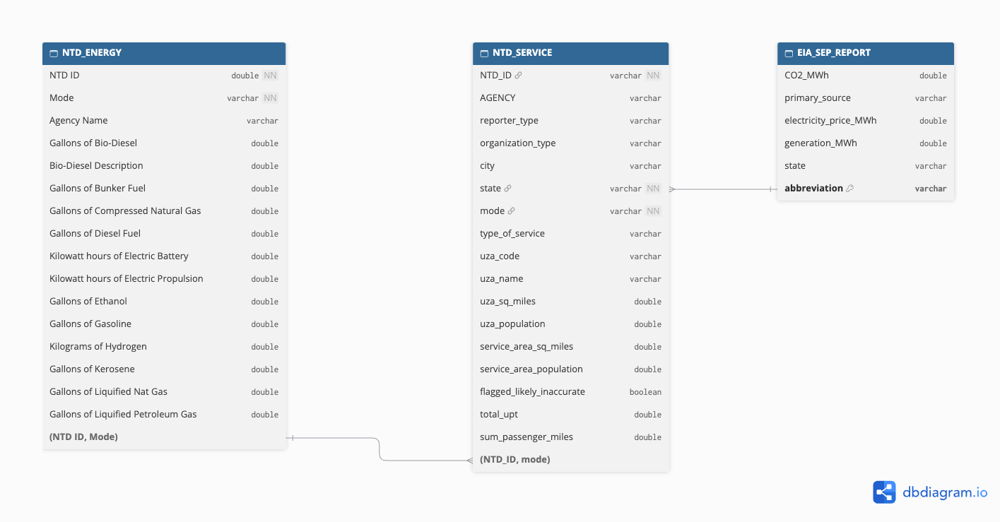

::: {.callout-note collapse="true"}
## Data Loading and Cleaning
```{r}
#| warning: false
#| message: false
library(tidyverse)
library(stringr)
library(httr2)
library(rvest)

get_eia_sep <- function(state, abbr){
    library(tidyverse)
    library(stringr)
    library(httr2)
    library(rvest)
    library(fs)
  
    state_formatted <- str_to_lower(state) |> str_replace_all("\\s", "")
    
    dir_name <- fs::path("data", "mp02")
    file_name <- fs::path(dir_name, state_formatted)
    
    fs::dir_create(dir_name, recurse=TRUE)
    
    if(!fs::file_exists(file_name) || fs::file_info(file_name)$size < 1000){
        Sys.sleep(0.5)

        BASE_URL <- "https://www.eia.gov"
        RESPONSE <- request(BASE_URL) |> 
          req_url_path("electricity", 
                       "state", 
                       state_formatted) |>
          req_headers(
            `User-Agent` = "Mozilla/5.0 (Macintosh; Intel Mac OS X 10.15; rv:149.0) Gecko/20100101 Firefox/149.0"
            ) |>   
          req_retry(
                max_tries = 4, 
          ) |>
          req_perform(file_name)
    
        resp_check_status(RESPONSE)
    }
    
    TABLE <- read_html(file_name) |> 
        html_element("table") |> 
        html_table() |>
        mutate(Item = str_to_lower(Item))
    
    if("U.S. rank" %in% colnames(TABLE)){
        TABLE <- TABLE |> rename(Rank = `U.S. rank`)
    }
    
    CO2_MWh <- TABLE |> 
        filter(Item == "carbon dioxide (lbs/mwh)") |>
        pull(Value) |> 
        str_replace_all(",", "") |>
        as.numeric()
    
    PRIMARY <- TABLE |> 
        filter(Item == "primary energy source") |> 
        pull(Rank)
    
    RATE <- TABLE |>
        filter(Item == "average retail price (cents/kwh)") |>
        pull(Value) |>
        as.numeric()
    
    GENERATION_MWh <- TABLE |>
        filter(Item == "net generation (megawatthours)") |>
        pull(Value) |>
        str_replace_all(",", "") |>
        as.numeric()
    
    data.frame(CO2_MWh               = CO2_MWh, 
               primary_source        = PRIMARY,
               electricity_price_MWh = RATE * 10, # / 100 cents to dollars &
               # * 1000 kWh to MWH 
               generation_MWh        = GENERATION_MWh, 
               state                 = state, 
               abbreviation          = abbr
    )
}

EIA_SEP_REPORT <- map2(state.name, state.abb, get_eia_sep) |> list_rbind()
```

```{r}
#| warning: false
#| message: false
load_ntd_energy <- function(){
  library(readxl)
  library(httr2)
  library(tidyverse)
  library(fs)
  
  # Create 'data/mp02' directory if not already present
  DATA_DIR <- fs::path("data", "mp02")
  fs::dir_create(DATA_DIR, recurse=TRUE)

  NTD_ENERGY_FILE <- fs::path(DATA_DIR, "2025_ntd_energy.xlsx")

  if(!fs::file_exists(NTD_ENERGY_FILE)){
    library(httr2)
  
    request("https://www.transit.dot.gov/") |>
      req_url_path("sites",
                   "fta.dot.gov",
                   "files",
                   "2026-09",
                   "2025 Energy Consumption_260806.xlsx") |> 
      req_headers(
        `User-Agent` = "Mozilla/5.0 (Macintosh; Intel Mac OS X 10.15; rv:149.0) Gecko/20100101 Firefox/149.0") |> 
      req_perform(NTD_ENERGY_FILE)
  }
  
  if(file.info(NTD_ENERGY_FILE)$size < 1e4){
        cat("I was unable to download the NTD Energy File. Please try again.\n")
        stop("Download failed. Please delete the corrupted file by running `unlink('data/mp02/2025_ntd_energy.xlsx')` and try again.")
    }

  to_numeric_fill_0 <- function(x){
    x <- if_else(x == "-", NA, x)
    replace_na(as.numeric(x), 0)
  }

  read_excel(NTD_ENERGY_FILE) |> 
    select(-c(`Reporter Type`, 
              `Reporting Module`, 
              `Gallons of Other Fuel`, 
              `Other Fuel Description`)) |>
    mutate(across(-c(`Agency Name`, 
                     `Mode`,
                     `TOS`), 
                  to_numeric_fill_0)) |>
    group_by(`NTD ID`, `Mode`, `Agency Name`) |>
    summarize(across(where(is.numeric), sum), 
              .groups = "keep") |>
    mutate(ENERGY = sum(c_across(c(where(is.numeric))))) |>
    filter(ENERGY > 0) |>
    select(-ENERGY) |>
    ungroup()
}

NTD_ENERGY <- load_ntd_energy()
```

```{r}
#| warning: false
#| message: false
load_ntd_service <- function(){
  library(httr2)
  library(tidyverse)
  library(fs)
  
  # Create 'data/mp02' directory if not already present
  DATA_DIR <- fs::path("data", "mp02")
  fs::dir_create(DATA_DIR, recurse=TRUE)

  NTD_SERVICE_FILE <- fs::path(DATA_DIR, "2025_ntd_service.csv")

  if(!fs::file_exists(NTD_SERVICE_FILE)){
    library(httr2)
  
    request("https://data.transportation.gov/resource/4fir-qbim.csv") |>
      req_url_query(`$query`=paste(
        "SELECT  `_5_digit_ntd_id` AS `NTD_ID`", 
        "`max_agency` AS `AGENCY`",
        "`max_reporter_type` AS `reporter_type`",
        "`max_organization_type` AS `organization_type`",
        "`max_city` AS `city`",
        "`max_state` AS `state`",
        "`mode`",
        "`type_of_service`",
        "`max_primary_uza_code` as `uza_code`",
        "`max_primary_uza_name` as `uza_name`",
        "`max_primary_uza_area_sq_miles` as `uza_sq_miles`",
        "`max_primary_uza_population` as `uza_population`",
        "`max_service_area_sq_miles` as `service_area_sq_miles`",
        "`max_service_area_population` as `service_area_population`",
        "`questionable_record` as `flagged_likely_inaccurate`",
        "`sum_unlinked_passenger_trips_upt` as `total_upt`",
        "`sum_passenger_miles` WHERE caseless_one_of(`report_year`, '2025') limit 50000", 
        sep=",")) |>
      req_headers(
        `User-Agent` = "Mozilla/5.0 (Macintosh; Intel Mac OS X 10.15; rv:149.0) Gecko/20100101 Firefox/149.0") |> 
      req_perform(NTD_SERVICE_FILE)
  }
  
  if(file.info(NTD_SERVICE_FILE)$size < 1e4){
        cat("I was unable to download the NTD Service File. Please try again.\n")
        stop("Download failed. Please delete the corrupted file by running `unlink('data/mp02/2025_ntd_service.csv')` and try again.")
    }

  read_csv(NTD_SERVICE_FILE) |>
    mutate(flagged_likely_inaccurate = !is.na(flagged_likely_inaccurate))
}

NTD_SERVICE <- load_ntd_service()
```

```{r}
#| warning: false
#| message: false
# Task 2: Recording the Mode column
# Record 2-letter mode codes in NTD_ENERGY to full names
NTD_ENERGY <- NTD_ENERGY |> 
  mutate(Mode = case_match(
    Mode,
    "DR" ~ "Demand Response",
    "FB" ~ "Ferryboat",
    "MB" ~ "Motorbus",
    "SR" ~ "Streetcar Rail",
    "TB" ~ "Trolleybus",
    "VP" ~ "Vanpool",
    "CB" ~ "Commuter Bus",
    "RB" ~ "Bus Rapid Transit",
    "LR" ~ "Light Rail",
    "MG" ~ "Monorail/Automated Guideway",
    "CR" ~ "Commuter Rail",
    "AR" ~ "Alaska Railroad",
    "TR" ~ "Aerial Tramway",
    "HR" ~ "Heavy Rail",
    "YR" ~ "Hybrid Rail",
    "IP" ~ "Inclined Plane",
    "CC" ~ "Cable Car",
    .default = "Unknown"
  ))

# Synchronize mode recoding in NTD_SERVICE for joining
NTD_SERVICE <- NTD_SERVICE |> 
  mutate(mode = case_match(
    mode,
    "DR" ~ "Demand Response",
    "FB" ~ "Ferryboat",
    "MB" ~ "Motorbus",
    "SR" ~ "Streetcar Rail",
    "TB" ~ "Trolleybus",
    "VP" ~ "Vanpool",
    "CB" ~ "Commuter Bus",
    "RB" ~ "Bus Rapid Transit",
    "LR" ~ "Light Rail",
    "MG" ~ "Monorail/Automated Guideway",
    "CR" ~ "Commuter Rail",
    "AR" ~ "Alaska Railroad",
    "TR" ~ "Aerial Tramway",
    "HR" ~ "Heavy Rail",
    "YR" ~ "Hybrid Rail",
    "IP" ~ "Inclined Plane",
    "CC" ~ "Cable Car",
    .default = "Unknown"
  ))
```
:::

## Extra Credit #01: Data Relationship Diagram

{width=100%}

## Data Integration and Initial Exploration

### Task 3a: Initial Analysis of EIA State Electricity Profiles

#### 1. Top 5 States with the Most Expensive Retail Electricity (Graph)

```{r}
#| warning: false
#| message: false
#| fig-cap: "Top 5 States with Most Expensive Electricity"

EIA_SEP_REPORT |>
  slice_max(order_by = electricity_price_MWh, n = 5, with_ties = FALSE) |>
  ggplot(aes(x = reorder(state, electricity_price_MWh), y = electricity_price_MWh)) +
  geom_col(fill = "steelblue") +
  coord_flip() +
  scale_y_continuous(labels = scales::dollar_format()) +
  labs(
  title = "Top 5 States with Most Expensive Electricity",
  subtitle = "Average retail electricity prices per MWh",
  caption = "Source: U.S. EIA State Electricity Profiles",
  x = "State",
  y = "Electricity Price ($ / MWh)"
) +
  theme_minimal()
```

#### 2. Top 5 States with the 'Dirtiest' Electricity Mix (Table)

```{r}
#| warning: false
#| message: false

EIA_SEP_REPORT |>
  slice_max(order_by = CO2_MWh, n = 5, with_ties = FALSE) |>
  select(
    State = state,
    `Abbreviation` = abbreviation,
    `Primary Source` = primary_source,
    `CO2 Emitted (lbs / MWh)` = CO2_MWh
  ) |>
  knitr::kable(caption = "Top 5 States with the Dirtiest Electricity Mix")
```

#### 3. Energy Cleanliness Comparison: New York vs. Texas (Inline)

```{r}
#| warning: false
#| message: false

ny_co2 <- EIA_SEP_REPORT |>
  filter(abbreviation == "NY") |>
  pull(CO2_MWh)

tx_co2 <- EIA_SEP_REPORT |>
  filter(abbreviation == "TX") |>
  pull(CO2_MWh)

ratio_cleaner <- tx_co2 / ny_co2
```

Texas emits `r round(tx_co2, 1)` pounds of CO2 per MWh, compared with
`r round(ny_co2, 1)` pounds in New York. Texas's electricity carbon
intensity is approximately `r round(ratio_cleaner, 2)` times New York's.

---

### Task 3b: Exploration of NTD Energy Usage

#### 1. Top 5 Transit Agencies by Gallons of Fuel Used (Table)

```{r}
#| warning: false
#| message: false

fuel_cols <- c(
  "Gallons of Bio-Diesel","Gallons of Bunker Fuel", "Gallons of Compressed Natural Gas", "Gallons of Diesel Fuel", "Gallons of Ethanol", "Gallons of Gasoline", "Gallons of Kerosene","Gallons of Liquified Nat Gas","Gallons of Liquified Petroleum Gas"
  )

NTD_ENERGY |>
  group_by(`Agency Name`) |>
  summarize(across(all_of(fuel_cols), ~ sum(.x, na.rm = TRUE))) |>
  mutate(Total = rowSums(pick(all_of(fuel_cols)))) |>
  slice_max(Total, n = 5, with_ties = FALSE) |>
  select(
    Agency = `Agency Name`,
    Total,
    Diesel = `Gallons of Diesel Fuel`,
    CNG = `Gallons of Compressed Natural Gas`,
    Gasoline = `Gallons of Gasoline`
  ) |>
  knitr::kable(
    digits = 0,
    format.args = list(big.mark = ","),
    caption = "Top 5 Transit Agencies by Fuel Used (Gallons)"
  )
```

CNG stands for compressed natural gas. Fuel types with zero consumption across all five agencies are omitted.

#### 2. Fuel Consumption by Type Across US Transit (Graph)

```{r}
#| warning: false
#| message: false
#| fig-cap: "Annual Fuel Usage Across US Public Transit"
#| fig-width: 9
#| fig-height: 4

NTD_ENERGY |>
  summarize(across(all_of(fuel_cols), ~ sum(.x, na.rm = TRUE))) |>
  pivot_longer(everything(), names_to = "Fuel", values_to = "Gallons") |>
  filter(Gallons > 0) |>
  mutate(Fuel = str_remove(Fuel, "^Gallons of ")) |>
  ggplot(aes(x = reorder(Fuel, Gallons), y = Gallons)) +
  geom_col(fill = "steelblue", width = 0.7) +
  coord_flip() +
  scale_y_continuous(
    labels = scales::label_number(scale = 1e-6, accuracy = 1)
  ) +
  labs(
    title = "Annual Fuel Usage Across US Public Transit",
    x = NULL,
    y = "Fuel Used (Million Gallons)"
  ) +
  theme_minimal(base_size = 12) +
  theme(
  panel.grid.major.y = element_blank(),
  plot.title = element_text(hjust = 0.5)
)
```
Fuel types with zero reported consumption are omitted.

#### 3. Least Commonly Used Fuel Source (Inline)

```{r}
#| warning: false
#| message: false

least_fuel <- NTD_ENERGY |>
  summarize(across(all_of(fuel_cols), ~ sum(.x, na.rm = TRUE))) |>
  pivot_longer(everything(), names_to = "Fuel", values_to = "Gallons") |>
  mutate(Fuel = str_remove(Fuel, "^Gallons of ")) |>
  filter(Gallons > 0) |>
  slice_min(Gallons, n = 1)

least_fuel_name <- least_fuel$Fuel[1]
least_fuel_gallons <- least_fuel$Gallons[1]
```

Among fuel categories measured in gallons with positive reported consumption,
the least used is `r least_fuel_name`, with a total of
`r format(round(least_fuel_gallons, 0), big.mark = ",")` gallons.

---

### Task 3c: Exploration of NTD Service Data

#### 1. Top 5 Transit Services by Annual UPT (Graph)

```{r}
#| warning: false
#| message: false
#| fig-cap: "Top 5 Transit Services by Annual UPT"

NTD_SERVICE |>
  group_by(AGENCY, mode) |>
  summarize(annual_upt = sum(total_upt, na.rm = TRUE), .groups = "drop") |>
  slice_max(order_by = annual_upt, n = 5, with_ties = FALSE) |>
  mutate(service_label = str_wrap(paste(AGENCY, mode), width = 30)) |>
  ggplot(aes(x = reorder(service_label, annual_upt), y = annual_upt)) +
  geom_col(fill = "steelblue") +
  coord_flip() +
  scale_y_continuous(labels = scales::label_number(scale = 1e-6, suffix = "M")) +
  labs(
  title = "Top 5 US Transit Services by Annual UPT",
  subtitle = "Annual unlinked passenger trips by transit agency and mode",
  caption = "Source: FTA 2025 National Transit Database",
  x = "Transit Service",
  y = "Total Unlinked Passenger Trips (UPT)"
) +
  theme_minimal()
```

#### 2. Average Trip Length on MTA NYC (Inline)

```{r}
#| warning: false
#| message: false

mta_trip_stat <- NTD_SERVICE |>
  filter(str_detect(AGENCY, "MTA New York City Transit")) |>
  summarize(
    total_pm = sum(sum_passenger_miles, na.rm = TRUE),
    total_upt = sum(total_upt, na.rm = TRUE),
    avg_trip_length = total_pm / total_upt
  )

mta_avg_trip <- mta_trip_stat$avg_trip_length
```

For MTA New York City Transit, the average trip length across all transit modes is approximately `r round(mta_avg_trip, 2)` miles per passenger trip.

#### 3. Are All States Represented? (Inline)

```{r}
#| warning: false
#| message: false


missing_states <- tibble(
  state = state.abb,
  State = state.name
) |>
  anti_join(NTD_SERVICE |> distinct(state), by = "state")
```

The dataset includes `r 50 - nrow(missing_states)` of the 50 US states. `r if (nrow(missing_states) == 0) "None" else paste(missing_states$State, collapse = ", ")` missing states.

## Data Analysis

### Task 5: Calculate Total Emissions per Agency-Mode Pair
```{r}
#| warning: false
#| message: false

# Add up trips and passenger miles for each agency-mode pair
service_clean <- NTD_SERVICE |>
  mutate(NTD_ID = as.character(NTD_ID)) |>
  group_by(NTD_ID, mode, AGENCY, state) |>
  summarize(
    total_upt = sum(total_upt, na.rm = TRUE),
    sum_passenger_miles = sum(sum_passenger_miles),
    .groups = "drop"
  )

# Combine service, energy, and EIA state emission table
transit_emissions <- service_clean |>
  inner_join(NTD_ENERGY |> mutate(`NTD ID` = as.character(`NTD ID`)), by = c("NTD_ID" = "NTD ID", "mode" = "Mode")) |>
  left_join(select(EIA_SEP_REPORT, abbreviation, CO2_MWh), by = c("state" = "abbreviation")) |>
  mutate(
    # CO2 estimates in pounds, using published factors and stated approximations
    co2_diesel    = coalesce(`Gallons of Diesel Fuel`, 0) * 22.45,
    co2_biodiesel = coalesce(`Gallons of Bio-Diesel`, 0) * 22.45,
    co2_gasoline  = coalesce(`Gallons of Gasoline`, 0) * 18.73,
    co2_cng = coalesce(`Gallons of Compressed Natural Gas`, 0) * (0.138 * 116.65),
    co2_lng = coalesce(`Gallons of Liquified Nat Gas`, 0) * (0.08482 * 116.65),
    co2_lpg       = coalesce(`Gallons of Liquified Petroleum Gas`, 0) * 12.68,
    co2_kerosene  = coalesce(`Gallons of Kerosene`, 0) * 21.78,
    co2_ethanol = coalesce(`Gallons of Ethanol`, 0) * (5.75 * 2.20462),
    co2_bunker    = coalesce(`Gallons of Bunker Fuel`, 0) * 24.78,
    
    # Grid electricity emissions: (kWh / 1000) * lbs CO2 per MWh
    electricity_kwh = coalesce(`Kilowatt hours of Electric Battery`, 0) +
                  coalesce(`Kilowatt hours of Electric Propulsion`, 0),

    co2_electric = if_else(
      electricity_kwh == 0,
      0,
      electricity_kwh / 1000 * CO2_MWh
    ),
    
    # Total emissions and emission intensity metrics
    total_co2_lbs = co2_diesel + co2_biodiesel + co2_gasoline + 
                    co2_cng + co2_lng + co2_lpg + co2_kerosene + 
                    co2_ethanol + co2_bunker + co2_electric,
    co2_per_passenger_mile = if_else(sum_passenger_miles > 0, total_co2_lbs / sum_passenger_miles, NA_real_),
    co2_per_upt            = if_else(total_upt > 0, total_co2_lbs / total_upt, NA_real_)
  )
```

Biodiesel, LPG, and bunker fuel use diesel, propane, and residual fuel oil as proxies. CNG assumes diesel gallon equivalents; LNG assumes 84,820 Btu/gallon. Ethanol includes biogenic CO2.

```{r}
#| warning: false
#| message: false

# Showing emission calculation results
transit_emissions |>
  select(
    Agency = AGENCY,
    Mode = mode,
    State = state,
    `Passenger Miles` = sum_passenger_miles,
    `Total CO2 (lbs)` = total_co2_lbs,
    `CO2 / Mile (lbs)` = co2_per_passenger_mile
  ) |>
  slice_max(order_by = `Passenger Miles`, n = 5, with_ties = FALSE) |>
  knitr::kable(
    digits = 2,
    format.args = list(big.mark = ","),
    caption = "Sample of Combined Transit Emissions for Top 5 Systems by Passenger Miles"
  )
```

### Task 6: Normalize Emissions to Transit Usage and Identify Efficient Agencies

```{r}
#| warning: false
#| message: false

# Sum emissions and transit usage across modes for each agency
agency_emissions <- transit_emissions |>
  group_by(NTD_ID, AGENCY, state) |>
  summarize(
    total_co2_lbs = sum(total_co2_lbs),
    total_upt = sum(total_upt, na.rm = TRUE),
    sum_passenger_miles = sum(sum_passenger_miles),
    .groups = "drop"
  ) |>
  filter(
    total_upt >= 100000,
    sum_passenger_miles > 0,
    !is.na(total_co2_lbs),
    total_co2_lbs >= 0
  ) |>
  mutate(
    co2_per_passenger_mile = total_co2_lbs / sum_passenger_miles,
    co2_per_upt = total_co2_lbs / total_upt
  )

# Top five agencies by emissions per passenger mile
agency_emissions |>
  slice_min(co2_per_passenger_mile, n = 5, with_ties = FALSE) |>
  select(
    Agency = AGENCY,
    State = state,
    `CO2 / Passenger Mile (lbs)` = co2_per_passenger_mile
  ) |>
  knitr::kable(
    digits = 3,
    format.args = list(big.mark = ","),
    caption = "Top 5 Most Efficient Agencies per Passenger Mile"
  )

# Top five agencies by emissions per UPT
agency_emissions |>
  slice_min(co2_per_upt, n = 5, with_ties = FALSE) |>
  select(
    Agency = AGENCY,
    State = state,
    `CO2 / UPT (lbs)` = co2_per_upt
  ) |>
  knitr::kable(
    digits = 3,
    format.args = list(big.mark = ","),
    caption = "Top 5 Most Efficient Agencies per Unlinked Passenger Trip"
  )
```

Compared agencies with at least 100,000 annual unlinked passenger trips (UPT), leaving out those with missing emissions or zero passenger miles. Agencies with lower CO2 emissions per UPT or passenger mile are considered more efficient.

### Task 7: Determine Award Winners

```{r}
#| warning: false
#| message: false

# Award 1: Lowest CO2 emissions per passenger mile
award_greenest <- agency_emissions |>
  slice_min(co2_per_passenger_mile, n = 1, with_ties = FALSE) |>
  mutate(Award = "Greenest Transit Agency")

# Self-created award: Highest CO2 emissions per passenger mile
award_worst <- agency_emissions |>
  slice_max(co2_per_passenger_mile, n = 1, with_ties = FALSE) |>
  mutate(Award = "Highest Emissions per Passenger Mile")

bind_rows(award_greenest, award_worst) |>
  select(
    Award,
    Agency = AGENCY,
    State = state,
    `Passenger Miles` = sum_passenger_miles,
    `CO2 / Passenger Mile (lbs)` = co2_per_passenger_mile
  ) |>
  knitr::kable(
    digits = 3,
    format.args = list(big.mark = ","),
    caption = "GTA IV Award Winners"
  )
```

```{r}
#| echo: false

median_rate <- median(agency_emissions$co2_per_passenger_mile)
green_rate <- award_greenest$co2_per_passenger_mile
worst_rate <- award_worst$co2_per_passenger_mile

green_pct_lower <- (1 - green_rate / median_rate) * 100
worst_multiple <- worst_rate / median_rate
```

### Task 8: Deliverable — Transit Award Press Release

#### **FOR IMMEDIATE RELEASE: 2026 Green Transit Awards**

CalVans takes the Greenest Transit Agency award in this year’s GTA IV analysis, while Plaquemines receives the Highest Emissions per Passenger Mile award.

Rankings use estimated CO2 emissions per passenger mile for agencies with at least 100,000 annual unlinked passenger trips. Agencies with missing emissions or no reported passenger miles were excluded.

#### **Greenest Transit Agency: CalVans**

CalVans wins with `r round(green_rate, 3)` lbs of CO2 per passenger mile,
about `r round(green_pct_lower, 1)`% below the median of
`r round(median_rate, 3)` lbs among the agencies compared.

```{r}
#| warning: false
#| message: false
#| echo: false
#| fig-width: 9
#| fig-height: 5

agency_emissions |>
  slice_min(co2_per_passenger_mile, n = 5, with_ties = FALSE) |>
  ggplot(aes(
    x = reorder(AGENCY, -co2_per_passenger_mile),
    y = co2_per_passenger_mile
  )) +
  geom_col(width = 0.6, fill = "seagreen") +
  coord_flip() +
  scale_x_discrete(labels = \(x) str_wrap(x, 30)) +
  labs(title = "Greenest Transit Agencies",
       subtitle = "Ranked by lowest CO2 emissions per passenger mile",
       caption = "Sources: FTA 2025 National Transit Database; U.S. EIA.",
       x = NULL, y = "CO2 per Passenger Mile (lbs)") +
  theme_minimal(base_size = 12) +
  theme(
    plot.title = element_text(face = "bold", hjust = 0.5),
    plot.subtitle = element_text(hjust = 0.5, color = "gray30")
  )
```

#### **Highest Emissions per Passenger Mile: Plaquemines**

Plaquemines receives the Highest Emissions per Passenger Mile award, with
`r round(worst_rate, 3)` lbs of CO2 per passenger mile,
about `r round(worst_multiple, 1)` times the median.
Its average ferry trip was only 0.5 miles, which may help explain
the high rate.

```{r}
#| warning: false
#| message: false
#| echo: false
#| fig-width: 9
#| fig-height: 5

agency_emissions |>
  slice_max(co2_per_passenger_mile, n = 5, with_ties = FALSE) |>
  ggplot(aes(
    x = reorder(AGENCY, co2_per_passenger_mile),
    y = co2_per_passenger_mile
  )) +
  geom_col(width = 0.6, fill = "indianred") +
  coord_flip() +
  scale_x_discrete(labels = \(x) str_wrap(x, 30)) +
  labs(title = "Highest Emissions per Passenger Mile",
       subtitle = "Ranked by highest CO2 emissions per passenger mile",
       caption = "Sources: FTA 2025 National Transit Database; U.S. EIA.",
       x = NULL, y = "CO2 per Passenger Mile (lbs)") +
  theme_minimal(base_size = 12) +
  theme(
    plot.title = element_text(face = "bold", hjust = 0.5),
    plot.subtitle = element_text(hjust = 0.5, color = "gray30")
  )
```

#### **Data Sources**

- [EIA State Electricity Data](https://www.eia.gov)
- [FTA Energy Consumption Data](https://www.transit.dot.gov/)
- [NTD Service Data](https://data.transportation.gov/resource/4fir-qbim.csv)
- [EIA CO2 Emissions Coefficients](https://www.eia.gov/environment/emissions/co2_vol_mass.php)

::: {.callout-note title="AI Usage Statement" collapse="true"}
Gemini and ChatGPT were used to refine table formatting and assist with `ggplot2` styling. They also helped check emission factor conversions and data logic. Additionally, they were used to provide background context and brainstorm ideas for the open-ended prompt. All non-code text and analytical interpretations were written without generative AI.
:::